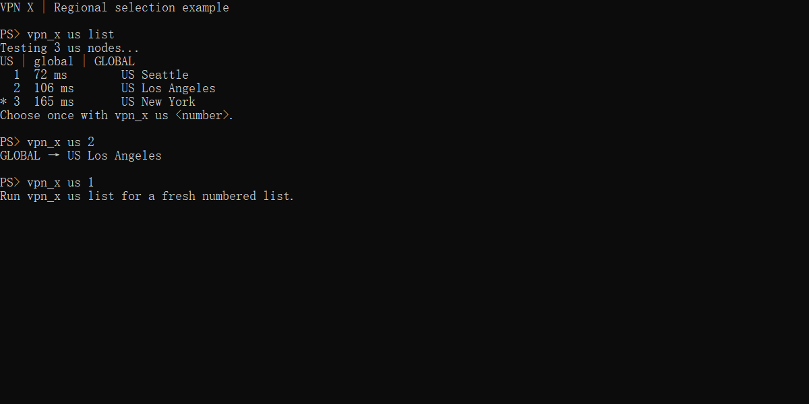

# X · Mihomo terminal

My Windows terminal client for Mihomo, based on [wzk0/mihomo-tui](https://github.com/wzk0/mihomo-tui) v1.4. I use PowerShell for node and mode changes and open the terminal UI for latency tests and logs.

## Daily commands

```powershell
vpn_x                              # Open the X console and start the core if needed
vpn_x status --json                 # Core, node, delay, TUN, and system proxy status
vpn_x start
vpn_x stop
vpn_x restart
vpn_x nodes GLOBAL                  # Node numbers, last latency, and current selection (*)
vpn_x use GLOBAL 3                  # Select node 3 in the group
vpn_x us list                       # Measure and list selectable US nodes
vpn_x us 2                          # Pick US node 2 and retire the list
vpn_x sg list                       # Measure and list selectable Singapore nodes
vpn_x sg 1                          # Pick Singapore node 1 and retire the list
vpn_x mode                          # Show the live routing mode
vpn_x mode rule                     # rule, global, or direct
vpn_x proxy status
vpn_x proxy on
vpn_x proxy off
vpn_x logs                         # Print the latest 50 log lines once
vpn_x logs 100                     # Print up to 100 recent lines
vpn_x tun status
vpn_x tun on
vpn_x tun off
```

`vpn_x` is my local launcher. The compiled executable supports the same subcommands. Put `--data`, `--home`, and `--bin` before subcommands when using the executable. It reads the controller settings from the active `config.yaml`. Run `vpn_x --help` for profile, backup, and core-update options.

### Node selection and routing

`vpn_x nodes <group>` numbers entries from 1 in the group's current order. The latency column shows the last result recorded by Mihomo. Entries without a result show `Untested`, and failed measurements can show `Timeout`. Run `vpn_x nodes <group>` again after refreshing or changing profiles, then pass the new number to `vpn_x use <group> <number>`.

`vpn_x us list` and `vpn_x sg list` measure matching nodes before numbering them, with successful results ordered by delay. The list uses `GLOBAL` in Global mode or the selectable MATCH group in Rule mode. Only the latest regional list is usable. A valid numbered choice retires the entire list. If the mode or profile changes, list again before choosing. Direct mode uses the direct outbound.



The screenshot uses sample node names and delays from a test controller.

In Global mode, Overview shows the final selection reached through `GLOBAL`. In Direct mode, it shows `DIRECT`. In Rule mode, **MATCH fallback** shows the default route. Use Logs to see the rule and outbound chosen for an individual connection.

`vpn_x status` uses the same route display and shows the node's last recorded delay. In JSON, `delayMs` is `null` when the delay is unavailable and `0` for a recorded timeout.

### Windows system proxy and TUN

The system proxy and TUN have independent controls. Release each one in the existing client before enabling it with `vpn_x`. The Windows TUN adapter is named `vpn_x`.

`vpn_x proxy` is shorthand for `vpn_x system-proxy`. `vpn_x logs [lines]` reads up to the requested number of entries from the newest 256 KiB of the core log and exits.

`vpn_x status` shows both controls. JSON reports `tun` as a boolean (or `null` when unknown), `tunDevice` when available, and `systemProxy` using the same ownership labels as `vpn_x system-proxy status`.

To enable TUN, run `vpn_x start` in an Administrator terminal, then run `vpn_x tun on`. If the core is already running without elevation, use `vpn_x restart` in that Administrator terminal before retrying. TUN and routing-mode changes apply to the running core. Run `vpn_x tun on` again after restarting the core.

## Keyboard controls

The proxy page highlights the full cursor row in the focused column. An asterisk marks the connected node.

| Key | Action |
| --- | --- |
| `1` / `2` / `3` / `4` / `5` | Overview / Profiles / Proxies / Logs / Settings |
| `Tab` / `←→` | Change focus or switch between groups and nodes |
| `Enter` | Select a node or run an action |
| `t` / `T` | Test one node or the entire group |
| `q` | Close the interface and keep the core running |

## Build on Windows x64

Use Dart SDK 3.13.7 and provide the Mihomo executable and your profile separately.

```powershell
dart pub get --enforce-lockfile
New-Item -ItemType Directory -Force build | Out-Null
dart compile exe bin/mihomo_tui.dart -o build/vpn_x.exe
.\build\vpn_x.exe --help
```

This build includes a Windows signal compatibility fix. For upstream profile management and backup instructions, see [the v1.4 documentation](https://github.com/wzk0/mihomo-tui/tree/v1.4).
